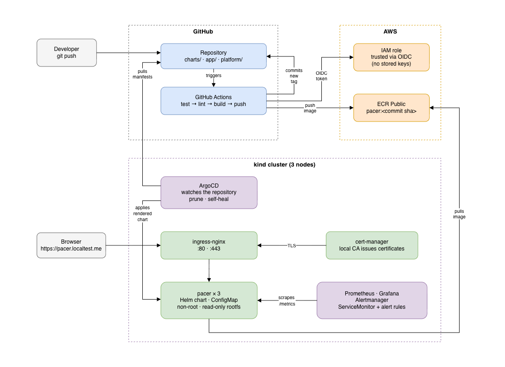

# Platform lab

The workload is **pacer**: a small API that works out your running pace.
It is deliberately boring. The interesting part is everything around it.


<sub>Source: [architecture.drawio](docs/diagrams/architecture.drawio) — open at app.diagrams.net</sub>

## What is in here

| Path | What it holds |
|---|---|
| `app/`, `tests/` | The application and its unit tests |
| `Dockerfile` | Non-root image, read-only filesystem |
| `cluster/` | kind configuration — three nodes, ports 80/443 mapped |
| `k8s/` | Plain manifests, kept as a reference |
| `charts/pacer/` | The Helm chart that actually gets deployed |
| `platform/` | ArgoCD, cert-manager and monitoring configuration |
| `terraform/` | ECR Public repository and the OIDC role for CI |
| `.github/workflows/` | Test, build, publish, commit the new tag |
| `docs/` | Architecture notes and a runbook |

## Two ways to deploy, on purpose

Plain manifests live in `k8s/` as a reference. Deployments go through the
Helm chart in `charts/pacer/`. I wrote the manifests first to see what
Kubernetes actually wants, before letting a templating engine write it for
me. Run `make chart-render` and you can watch the chart turn back into the
same YAML.

## Running it

You need Docker, kind, kubectl, helm and an entry in your hosts file:

```
127.0.0.1 pacer.localtest.me
127.0.0.1 grafana.localtest.me
```

Then:

```bash
make up           # three-node cluster
make ingress      # ingress-nginx, pinned version
make certmanager  # cert-manager and the local CA
make argocd       # the GitOps controller
make argocd-app   # hand it this repository
make monitoring   # Prometheus, Grafana, Alertmanager
```

From that point the cluster deploys itself from this repository. Open
<https://pacer.localtest.me> and <https://grafana.localtest.me>.

`make help` lists everything. `make down` deletes the lot.

## The application

| Endpoint | What it does |
|---|---|
| `GET /` | A box to type a distance and a time into |
| `POST /api/pace` | The calculation |
| `GET /healthz` | Liveness — is the process alive |
| `GET /readyz` | Readiness — should it get traffic |
| `GET /metrics` | Prometheus metrics |
| `GET /version` | Reads a value from the ConfigMap, handy for checking a rollout landed |

## Notes

[`docs/architecture.md`](docs/architecture.md) — why things are built the
way they are, and what I would change before putting this anywhere real.

[`docs/runbook.md`](docs/runbook.md) — rebuilding from scratch, and the
failures I hit along the way.
